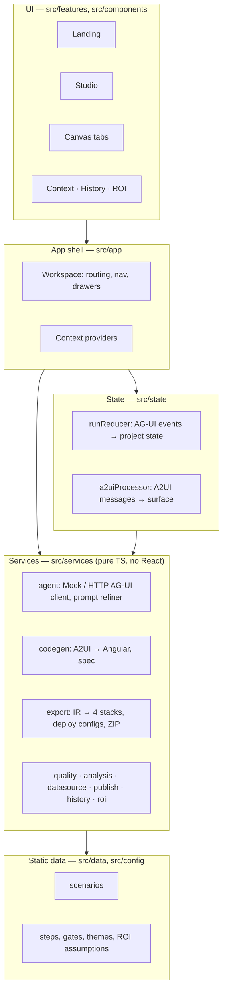
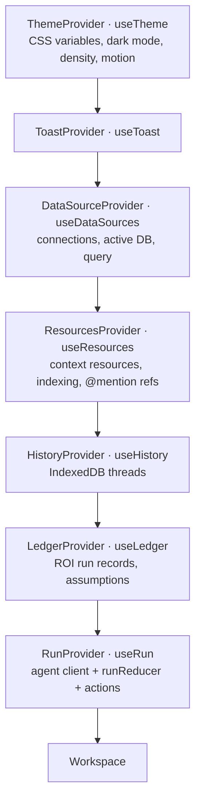
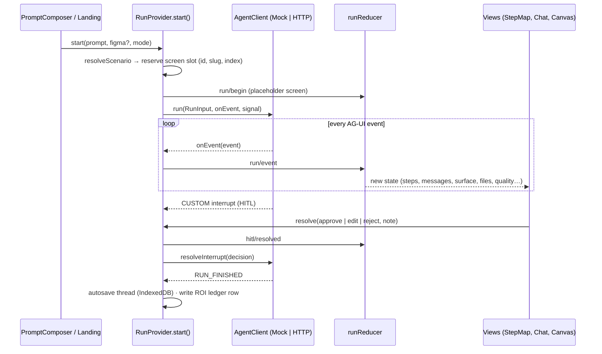

# 02 · Architecture

## Layers



**Dependency rule:** `features` → `app/providers` → `state` / `services` → `data` / `config` / `types` / `utils`. Services never import React. Reducers and engines are pure functions, so they are easy to test.

## Folder map

```
src/
├─ main.tsx                 Entry: mounts <App/>, imports styles/main.scss
├─ app/
│  ├─ App.tsx               Provider stack
│  ├─ Workspace.tsx         Shell: hash routing, left nav, page slot, drawers, view transitions
│  └─ providers/            Theme · Toast · DataSource · Resources · History · Ledger · Run
├─ features/                One folder per product area (component + .module.scss)
│  ├─ landing/              Hero, LandingPrompt, PromptRefine (wand), templates
│  ├─ nav/                  AppNav (rail/drawer), routing (useHashRoute), PageHeader
│  ├─ chat/                 ChatThread, PromptComposer (@mentions, context row)
│  ├─ steps/                StepMap (8 steps, tool calls, timings)
│  ├─ hitl/                 HitlCard (approve / edit / reject)
│  ├─ screens/              ScreenStrip (switch / add screens)
│  ├─ canvas/               CanvasPanel + tabs: preview, flow, spec, code, quality, events
│  ├─ export/ publish/      Export wizard (stack picker, analysis) · Publish dialog (providers)
│  ├─ data/                 DataSourcesDrawer
│  ├─ resources/ history/   Context page · History page
│  ├─ roi/                  RoiPage, charts, AssumptionsDrawer
│  ├─ header/ settings/     Studio header · Theme & settings drawer
├─ components/ui/           Design-system primitives (Button, Badge, Tabs, Modal, Drawer, Icon…)
├─ state/                   runReducer.ts, a2uiProcessor.ts
├─ services/
│  ├─ agent/                AgentClient interface, HttpAgentClient, mock/ (flows, helpers, context, refinements), promptRefiner
│  ├─ codegen/              angular.ts (A2UI → Angular files), spec.ts (Markdown spec)
│  ├─ export/               ir.ts, render.ts, stacks.ts (4 project builders), css.ts, angularKit.ts, zipExport.ts
│  ├─ analysis/             analyzeCode.ts (static checks on generated files)
│  ├─ quality/              scoring.ts (weighted score, hard gates, decision)
│  ├─ datasource/           client (mock / HTTP), mockDatabase, bindings
│  ├─ publish/              publish client (mock / HTTP), deployConfig (provider files)
│  ├─ history/              threadStore (IndexedDB)
│  └─ roi/                  engine (value calculations), sampleData
├─ data/scenarios/          Built-in screen patterns + generic builder + matcher
├─ config/                  app.ts (steps, gates, weights, env), themes.ts, roi.ts
├─ types/                   agui, a2ui, run, project, scenario, export, datasource, resources, roi, theme
├─ hooks/ utils/            useMediaQuery, useEscape, useLocalStorage… · format, color, jsonPatch
└─ styles/                  abstracts (mixins, breakpoints), base (tokens, reset, typography, view transitions)
```

## Provider stack

Each provider owns one concern and exposes a hook.



`RunProvider` sits innermost because it uses all the others: it reads the active data source and resources when starting a run, autosaves to history, and writes ledger rows.

## Runtime flow of a run (client side)



## Routing and shell

- `features/nav/routing.ts` → `useHashRoute()` maps `#/`, `#/studio`, `#/resources`, `#/history` and `#/roi` to a `Route`. Hash routing keeps the app static-hostable.
- `Workspace.tsx` switches pages and wraps route changes in `document.startViewTransition` when it is available. The landing prompt bar morphs into the Studio composer through `view-transition-name: aava-prompt`.
- The **left nav** is a 76px rail that expands to 268px on desktop. It starts collapsed on tablets and becomes an off-canvas drawer on phones (`NavMenuContext` opens it). ⌘/Ctrl+B toggles it, and the preference is saved in `aava-p2p.nav.v1`.

## Swappable backends

| Concern | Default (offline) | Real backend | Switch |
|---|---|---|---|
| Agent | `MockAgentClient`: scripted flows, demo data | `HttpAgentClient`: AG-UI over SSE | `VITE_AGENT_URL` |
| Prompt refine | Local rule-based refiner | `POST {AGENT_URL}/refine` | `VITE_AGENT_URL` |
| Database | `MockDataSourceClient`: 8 demo tables | `HttpDataSourceClient` | `VITE_DATA_API_URL` |
| Publish | `MockPublishClient`: simulated deploy log | `HttpPublishClient`: POST ZIP | `VITE_PUBLISH_URL` |

The UI depends only on the interfaces (`AgentClient`, `DataSourceClient`, `PublishClient`), so swapping a backend never touches components.
