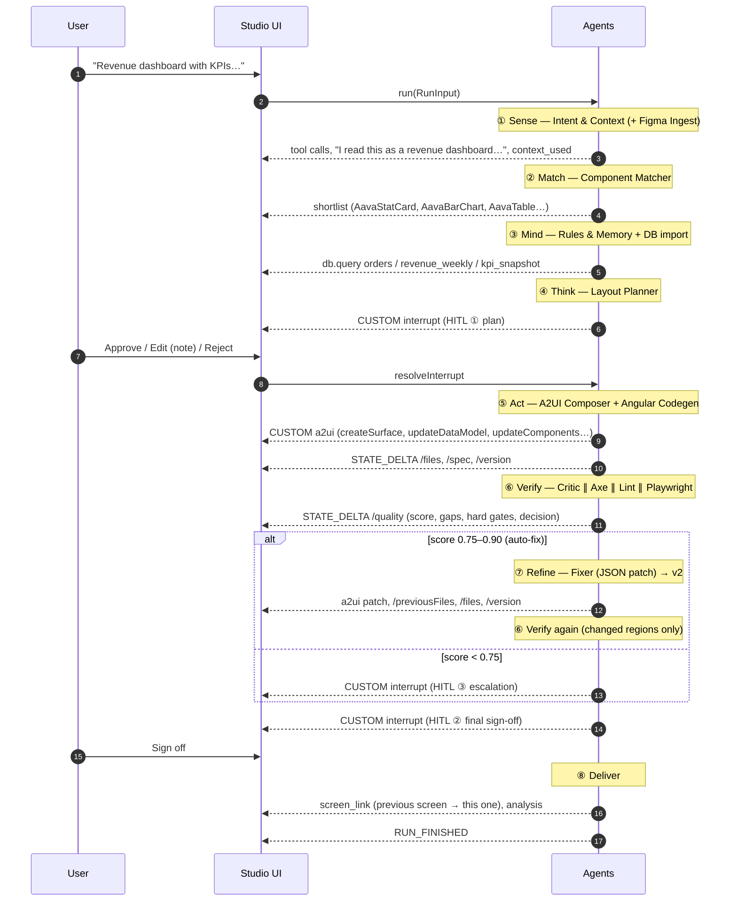
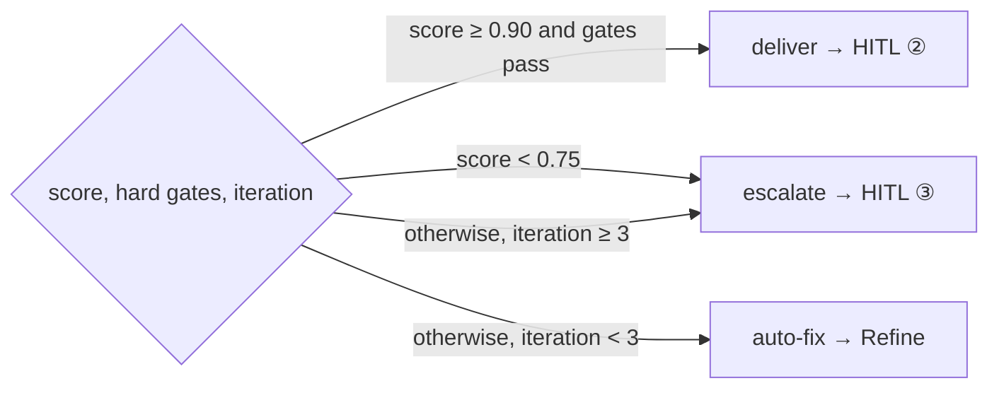

# 03 · Agent pipeline

The pipeline is the **AAVA Process Flow**: **Sense → Match → Mind → Think → Act → Verify → Refine → Deliver**. Each full run builds exactly **one new screen** and adds it to the project flow. The reference implementation is the mock agent in [`services/agent/mock/flows.ts`](../src/services/agent/mock/flows.ts). A real backend must emit the same events (see [04](04-protocol.md)).

## The agents

There are 12 agents. The model tier decides cost and latency. `none` means the agent is deterministic code that uses no LLM tokens. Tiers are configured in [`config/roi.ts` → `AGENT_TIERS`](../src/config/roi.ts).

| # | Agent | Step | Tier | Responsibility | Tools it calls |
|---|---|---|---|---|---|
| 1 | **Intent & Context** | Sense | small | Parse the prompt into an intent (screen type, entities), position the screen in the flow | `prompt.parse`, `codebase.search`, `figma.library`, `db.introspect` |
| 2 | **Figma Ingest** | Sense | small | Read the frame tree and reference image, snap raw values to AAVA tokens (only when a Figma link is given) | `figma.getNodes`, `figma.getImages`, `tokens.normalize` |
| 3 | **Component Matcher** | Match | small | Shortlist AAVA Play components for the intent | `catalog.search` |
| 4 | **Rules & Memory** | Mind | small | Build the context pack: design rules, docs, API specs and imported DB rows, within a token budget | `kb.retrieve`, `docs.retrieve`, `openapi.match`, `db.query` / `seed.load`, `context.budget` |
| 5 | **Layout Planner** | Think | large | Propose a layout plan and an alternative. Triggers **HITL ①** | `patterns.lookup` |
| 6 | **A2UI Composer** | Act | medium | Stream the A2UI surface (components + data model), catalog-only | `a2ui.validate` |
| 7 | **Angular Codegen** | Act | none | Compile A2UI → Angular files + Markdown spec, deterministically | `codegen.angular` |
| 8 | **Critic** | Verify | large | Review UX and design principles | `critic.review` |
| 9 | **Accessibility Audit** | Verify | none | axe scan, WCAG 2.2 AA | `axe.scan` |
| 10 | **Design Lint** | Verify | none | Raw colours, off-scale spacing, non-catalog components | `designLinter.run` |
| 11 | **Playwright Verifier** | Verify | none | Visual check at 3 breakpoints against the Figma baseline | `playwright.verify` |
| 12 | **Fixer** | Refine | small | Turn gaps into targeted **JSON patches** on the A2UI tree (no regeneration) | `fixer.jsonPatch`, `codegen.angular` |

Deliver is orchestration rather than an LLM agent: `project.save`, `flow.link`, `analysis.run`.

**8 agents use an LLM and 4 are deterministic:**

- **Small tier:** Intent & Context, Figma Ingest, Component Matcher, Rules & Memory, Fixer.
- **Medium tier:** A2UI Composer.
- **Large tier:** Layout Planner, Critic.
- **Deterministic** (no tokens): Angular Codegen, Accessibility Audit, Design Lint, Playwright Verifier.

Figma Ingest only runs when a Figma link is given, and Fixer only runs when quality is below the deliver threshold. A typical prompt-only screen that passes first time therefore uses **6 LLM agents**, and only two of them use the large tier. Keeping code generation and checking deterministic is the main reason a screen costs cents rather than dollars (see [08](08-roi.md)).

## Full run, step by step

### ① Sense
- Resolves the **scenario** with `resolveScenario(prompt, hasFigma)` in [`data/scenarios/index.ts`](../src/data/scenarios/index.ts). It uses keyword scoring over 10 built-in patterns. If the first line of a refined brief names a pattern ("Revenue dashboard — …"), that pattern wins. A Figma link with no keyword match defaults to sign-in, and anything else gets a **generic** scenario built from the prompt.
- With a Figma link it fetches nodes and images and normalises tokens. The access token stays server-side (the "vault").
- Grounds on enabled **context resources**: codebase search and Figma library ([07](07-data-and-context.md)).
- Introspects the connected **database** when the scenario needs data.
- Output: Intent JSON, a chat message and a `context_used` event.

### ② Match
Shortlists catalog components with reasons and scores (`scenario.shortlist`).

### ③ Mind
- Retrieves rules and docs (`kb.retrieve`, `docs.retrieve`) and matches OpenAPI endpoints.
- **Imports data**: for each `dataNeed` it runs `db.query` (or `seed.load` with no database), patches component props with real rows and records a `CollectionBinding`. The generated code later fetches the same collection through `AavaApiService`.
- Reports the context budget (`3.6k / 8k tokens`).

### ④ Think and HITL ① (plan)
- The Layout Planner posts the plan summary, then raises an interrupt with the plan items.
- **Approve** continues. **Edit + note** folds the note into the plan and the spec. **Reject** switches to the alternative plan; a second reject stops the run.
- With **auto-approve** on (Settings), HITL ① is skipped.

### ⑤ Act
- Streams the A2UI surface: `createSurface` (catalog `aava-play@1`), `updateDataModel`, then `updateComponents` **one node at a time** so the preview assembles visibly. The Preview's build theatre animates this ([`useBuildPhase`](../src/features/canvas/preview/useBuildPhase.ts)).
- Validates the tree against the catalog.
- **Angular Codegen** compiles the files: `<slug>.component.ts/html/scss` and `verify/<slug>.spec.ts`. It also generates the **spec** (Markdown).
- Emits `STATE_DELTA` for `/files`, `/spec`, `/version` (1), `/changelog` and `/bindings`.

### ⑥ Verify
- The four verifiers run **in parallel**; wall-clock time equals the slowest of them.
- Findings are merged and deduplicated into **gaps** (`el`, `prop`, `found → expected`, `rule`, `severity`, `source`).
- `buildQuality()` in [`services/quality/scoring.ts`](../src/services/quality/scoring.ts) computes the score and the decision.

**Weighted score** (from `QUALITY_WEIGHTS`):

| Dimension | Weight |
|---|---|
| Design-token compliance | 0.25 |
| Component conformance | 0.20 |
| Visual fidelity (Playwright) | 0.20 |
| Accessibility (WCAG 2.2 AA) | 0.20 |
| Critic (principles & UX) | 0.15 |

**Hard gates** (all must pass to deliver): 0 Design-Linter errors · 0 critical/serious axe violations · no unmapped raw colours.

**Decision** (`decide()`):

### ⑦ Refine (Fixer)
- Converts the scenario's fixes into JSON-patch ops on the A2UI tree and replaces off-token styles with tokens.
- Streams only the **changed components** and recompiles code. `previousFiles` is kept so the **Diff** view works. Version becomes v2 and a changelog entry is added.
- Verify then re-runs on the **changed regions only**, which is faster and cheaper.
- From **HITL ③**, the reviewer can choose *Apply fixes*, *Fix with guidance* (a note recorded in the changelog) or *Keep as is* (gaps stay open).

### HITL ② (final sign-off)
A summary of the score, lint errors and critical accessibility issues, plus per-dimension scores. **Sign off** proceeds to Deliver. **Not yet** keeps a draft and invites refinement.

### ⑧ Deliver
- `project.save` places the screen at position *n/10* with route `/<slug>`.
- `flow.link` emits `screen_link` so the **previous screen's primary action** (e.g. *Sign in*) navigates to this screen.
- `analysis.run` runs static analysis on the generated files ([06](06-codegen-export-publish.md)).

## Refine run (plain-language edits)

A prompt sent while a built screen is active (Composer in *Refine* mode) starts a **refine run**:

| Step | Behaviour |
|---|---|
| Sense | Parse the refinement intent |
| Match, Mind, Think | **Skipped** (`step_skipped`): shortlist reused, context pack cached (prompt-cache hit), plan unchanged |
| Act | `applyRefinement()` maps the request to JSON-patch ops, streams the changed components and recompiles → v(n+1) |
| Verify | Lint + Playwright on changed regions |
| Refine | Skipped (score held) |
| Deliver | Save + analysis |

The supported intents are in [`mock/refinements.ts`](../src/services/agent/mock/refinements.ts): change heading text (quoted), make buttons full width, change the main button variant (primary/secondary/ghost), and remove an element by id or label. Anything else gets suggestions instead of a guess. A real backend would replace this with an LLM Fixer.

## Telemetry emitted along the way

Every agent invocation emits `CUSTOM usage`: agent, step, tier, input/output/cached tokens and latency. Cached share is 20% on the first screen and 55% for later screens and refinements, because stable design context is prompt-cached. The reducer also measures **human wait time** at each interrupt. Both are written to the ROI ledger when the run ends ([08](08-roi.md)).

## Statuses and step states

- Run status: `idle → running ⇄ waiting (HITL) → finished | error | cancelled`.
- Step status: `pending → running → done | skipped | waiting`, with tool calls, iterations (Verify ×2) and duration.
- **Stop** aborts the `AbortController`. Pending interrupts reject and the run becomes `cancelled`. A cancelled first-screen placeholder with no surface is dropped.
