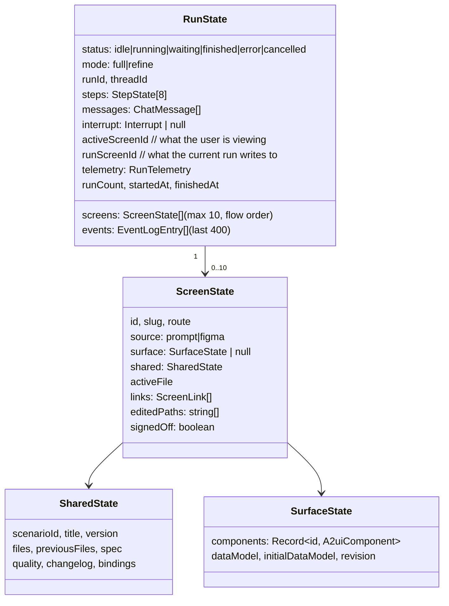

# 05 · State & persistence

## Shape

A conversation is one `RunState` ([`state/runReducer.ts`](../src/state/runReducer.ts)) owned by `RunProvider`.

**`activeScreenId` and `runScreenId` are separate.** The user can view and edit screen 1 while screen 3 is being built. Agent events always target `runScreenId`.

## Actions

| Action | Purpose |
|---|---|
| `run/begin` | Add the user message, reset steps, insert a placeholder screen (full run), set `runScreenId` |
| `run/event` | Apply one AG-UI event (see [04](04-protocol.md)) |
| `run/cancelled` · `run/failed` | End the run; drop an empty placeholder |
| `hitl/resolved` | Record the decision in chat, add human wait time to telemetry, mark the screen `signedOff` on final approval |
| `files/edit` · `files/select` | Edit or select a generated file on any screen (`screenId` optional, defaults to active) |
| `surface/setData` · `surface/resetData` | Preview interactions write to the data model; reset restores the agent's model |
| `screen/select` · `screen/delete` | Switch or remove a screen (removal also removes links pointing to it) |
| `screen/link` | Link `action` on one screen to a target screen (or unlink) |
| `screen/reorder` | Apply a confirmed new order from the Flow tab; `relink: true` re-chains primary actions along the new order |
| `screen/applyData` | Manual DB binding: patch components, replace files and spec, bump version |
| `workspace/reset` · `workspace/load` | New chat · reopen a saved thread |
| `chat/system` | System notices in the chat |

The reducer is a pure function, and every handler returns new objects. Helpers:

- `selectActiveScreen` and `selectRunScreen`.
- `primaryActionOf(screen)` picks the action that most likely moves the user forward. It prefers a primary button, then other buttons, links, then row clicks, and ignores side actions like *cancel*, *back*, *SSO* and *forgot*. The flow uses it to auto-link screens.
- `actionsOf(screen)` lists all named actions; the Flow tab's link editor uses it.

## Flow (screen order and links)

- A new screen is appended; Deliver links the **previous** screen's primary action to it.
- **Flow tab:** drag or move screens to reorder, then **Confirm order**. With *Re-link* on, links are rebuilt as a chain 1 → 2 → … → n. Links can also be edited per action.
- Preview clicks follow links (prototype mode); unlinked actions go to the agent.
- Export uses the same links to generate the router (each linked action navigates to the target route).

## Persistence

Nothing goes to a server unless a backend URL is configured. All browser storage is per device.

| Data | Where | Key / store |
|---|---|---|
| Conversations: messages, screens, code, specs, quality | IndexedDB | DB `aava-p2p`, store `threads` ([`services/history/threadStore.ts`](../src/services/history/threadStore.ts)). Autosaved 600 ms after each run settles, never mid-run |
| Theme settings | localStorage | `aava-p2p.theme.v1` |
| Run options (auto-approve plan, speed) | localStorage | `aava-p2p.run-options.v1` |
| Step map open/closed | localStorage | `aava-p2p.steps-open.v1` |
| Nav expanded preference | localStorage | `aava-p2p.nav.v1` |
| Data source connections (no credentials) | localStorage | `aava-p2p.data-sources.v1` |
| Context resources (no tokens) | localStorage | `aava-p2p.resources.v1` |
| Deploy settings / deployment history | localStorage | `aava-p2p.deploy-settings.v1`, `aava-p2p.deployments.v1` |
| ROI ledger, assumptions, dashboard prefs | localStorage | `aava-p2p.roi-ledger.v1`, `aava-p2p.roi-assumptions.v1`, `aava-p2p.roi-prefs.v1` |

**Secrets are never persisted.** This covers Figma tokens, database passwords, resource access tokens and cloud deploy tokens. They are sent only to the corresponding backend (vault / BFF) when used.

## Run telemetry → ROI ledger

During a run the reducer accumulates `telemetry`:

- `usage[]` comes from `CUSTOM usage` events.
- `hitlDecisions` and `hitlWaitMs` come from the time between an interrupt and its decision.
- `firstGaps` is the gap count of the first Verify, before auto-fix.

When the run ends (finished, cancelled or error), `RunProvider` writes **one** `RunRecord` to the ledger with the outcome (`delivered | draft | escalated | cancelled | error`), component count and complexity, files and LOC, scores, iterations, and gaps fixed or remaining. See [08](08-roi.md).
