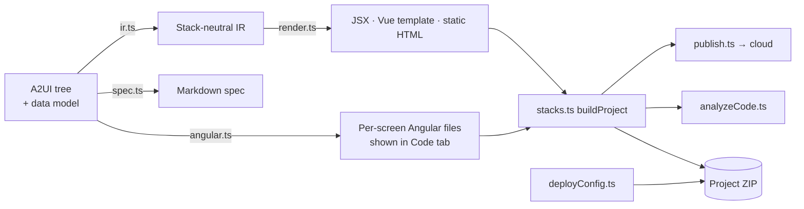

# 06 · Codegen, export & publish

## 1. Per-screen code generation (Act step)

[`services/codegen/angular.ts`](../src/services/codegen/angular.ts) is the **Angular Codegen** agent. It is deterministic: the LLM decides *what* to build (the A2UI tree), and this code decides *how* it is written.

For each screen `<slug>` it generates:

| File | Contents |
|---|---|
| `<slug>/<slug>.component.ts` | Standalone component importing AAVA Play components; `FormBuilder` group for bound inputs; action handlers; linked actions navigate via `Router`; DB-bound collections load through `AavaApiService` with the imported rows as seed |
| `<slug>/<slug>.component.html` | Template mapped from the A2UI tree (`aava-*` elements, `formControlName`, `@for` over collections) |
| `<slug>/<slug>.component.scss` | Layout styles using AAVA tokens only. Version 1 deliberately includes the scenario's off-token *defects*, which Verify catches and Refine removes |
| `verify/<slug>.spec.ts` | Playwright test: renders, key elements visible, 3 breakpoints |

[`services/codegen/spec.ts`](../src/services/codegen/spec.ts) generates the **Spec** tab. It covers intent, source, route, plan and reviewer notes, the component inventory, the data model and bindings, states, responsive rules, quality, changelog and grounding sources.

Code is regenerated on every version change (Act, Refine, refine runs, manual data binding). Hand edits in the Code tab are kept until the next regeneration.

## 2. Code tab

[`features/canvas/code`](../src/features/canvas/code/CodePane.tsx) has two scopes:

- **All screens** (default with 2+ screens): the whole project ([`projectFiles.ts`](../src/features/canvas/code/projectFiles.ts)).
  - **App shell**: `app.routes.ts`, `app.config.ts`, `app.component.ts`, `main.ts`, environment and `tokens.css`. These are regenerated from the current flow and are read-only.
  - Every screen's files, in flow order and editable. Paths match the export layout: `src/app/screens/<slug>/…` and `e2e/<slug>.spec.ts`.
- **This screen**: only the active screen's files.

Other features: Monaco with syntax checking, a filter box, Diff against the previous version, Copy, and **ZIP** (whole project or one screen). Each file opens in a fresh editor instance, so switching files can never write one file's content into another.

## 3. Export (multi-stack project)

The **Export** wizard ([`features/export/ExportDialog.tsx`](../src/features/export/ExportDialog.tsx)) has three steps:

1. **Pick a stack.**
2. **Options:** project name, which screens to include, tests, data, Docker, CI, the Angular AAVA source, data API URL and deploy target.
3. **Review:** file tree preview and code analysis, then download.

### Stacks ([`services/export/stacks.ts`](../src/services/export/stacks.ts))

| Stack | Output | Run |
|---|---|---|
| **Angular 21** (reference) | Standalone components on AAVA Play, lazy routes, `AavaApiService`, environments | `npm install && npm start` |
| **React 19 + Vite** | TSX screens, React Router, `useCollection` hook | `npm install && npm run dev` |
| **Vue 3 + Vite** | `<script setup>` SFCs, Vue Router, `useCollection` | `npm install && npm run dev` |
| **Static HTML/CSS/JS** | One `index.html` with sections, hash router in `assets/app.js` | `npm install && npm start` (serve) |

React, Vue and HTML are produced from a **stack-neutral IR** ([`ir.ts`](../src/services/export/ir.ts) → [`render.ts`](../src/services/export/render.ts)). Repeating data (rows, bars, list items, options) becomes `each` nodes over named collections, so the code can load them live.

**Angular AAVA source:** the default is the **portable kit**. It generates `src/app/aava-play/index.ts` with a `tsconfig` path alias `@aava/play`, so `npm install` works from public npm. *Registry* mode uses the internal `@aava/play` package and needs `.npmrc` access.

### Files every project gets

`package.json` (pinned engines), `README.md`, `.gitignore`, `.nvmrc`, `.env.example`, design tokens (`tokens.css` from the current theme) and AAVA Play CSS, plus the per-screen seed data `data/<slug>.json` when data is included.

Optional extras:

- **Tests:** `playwright.config.ts` and e2e specs.
- **Docker:** `Dockerfile`, `nginx.conf` and `.dockerignore`.
- **CI:** `.github/workflows/ci.yml`.
- **API:** `VITE_API_URL`/`environment.apiUrl`. Leave it empty to use the seed data.

### Deploy configs ([`services/publish/deployConfig.ts`](../src/services/publish/deployConfig.ts))

| Provider | Generated files |
|---|---|
| Vercel | `vercel.json` (framework, output dir, SPA rewrites, region, headers) |
| Netlify | `netlify.toml` (build, publish, redirects, headers) |
| AWS (S3 + CloudFront) | `.github/workflows/deploy-aws.yml` |
| Azure Static Web Apps | `staticwebapp.config.json`, `.github/workflows/azure-static-web-apps.yml` |
| Google Cloud Run | `cloudbuild.yaml`, `deploy/Dockerfile.cloudrun`, `deploy/nginx.cloudrun.conf` |

Plus `DEPLOY.md` with the exact commands and `.env.production` with your environment variables (secrets are never written).

## 4. Code analysis

[`services/analysis/analyzeCode.ts`](../src/services/analysis/analyzeCode.ts) runs at Deliver and in the Export review.

| Rule | Severity | Checks |
|---|---|---|
| `DS-COLOR-01` | error | Raw hex/rgb colour instead of an AAVA token |
| `DS-SPACE-01` | warning | Spacing off the 4px scale |
| `DS-COMP-03` | error | Non-catalog component in output |
| `A11Y-ALT` | error | `` without `alt` |
| `A11Y-LABEL` | error | Form field without an accessible label |
| `TS-ANY` | warning | Explicit `any` |
| `CODE-CONSOLE` | warning | `console.log` left in |
| `CODE-TODO` | info | TODO markers |
| `GATE-HARD` | error | Screen exported with failing hard quality gates |
| `FLOW-SIGNOFF` | warning | Screen not signed off (HITL ②) |
| `FLOW-ORPHAN` | info | Screen not reachable from any other screen |
| `PKG-JSON` | error | Invalid `package.json` |

## 5. Publish

The **Publish** dialog ([`features/publish`](../src/features/publish/PublishDialog.tsx)) lets you choose the provider, environment (preview or production), region, provider settings, environment variables and token.

- **Mock** (default): a simulated build and deploy log, ending with a provider-style URL.
- **HTTP** (`VITE_PUBLISH_URL`): `POST {url}/deployments` with the project ZIP. Credentials go in an `X-Deploy-Credentials` header and are never stored. The response gives the live URL.

Deployment history is kept in `aava-p2p.deployments.v1`.

## 6. ZIP

[`zipExport.ts`](../src/services/export/zipExport.ts) loads JSZip on demand and saves through a temporary object URL. There is no `file-saver` dependency.
