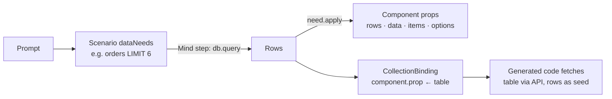

# 07 · Data, context & prompt refine

## Data sources (databases)

Data sources are managed in the **Data sources** drawer ([`features/data`](../src/features/data/DataSourcesDrawer.tsx)) and provided by `DataSourceProvider`.

- **Kinds:** PostgreSQL, MySQL, SQL Server, MongoDB, REST API.
- **Connection flow:** add → test connection → connected. One source is **active**, and it is shown as the database chip on the prompt bar.
- **Clients** ([`services/datasource/client.ts`](../src/services/datasource/client.ts)):
  - `MockDataSourceClient` (default) serves 8 demo tables from [`mockDatabase.ts`](../src/services/datasource/mockDatabase.ts): `orders`, `customers`, `products`, `users`, `revenue_weekly`, `kpi_snapshot`, `notifications`, `cart_items`.
  - `HttpDataSourceClient` (`VITE_DATA_API_URL`): `GET /sources/:id/tables` and `GET /sources/:id/tables/:name?limit=`.
- Credentials are never stored in the browser.

### How data enters a screen

1. **Automatic (during a run).** Each scenario declares its `dataNeeds` (table, limit and which component props they feed). In **Mind** the agent queries each table (`db.query`, or `seed.load` with no database), patches the components and records bindings.
2. **Manual (after a run).** The Preview's bind panel lists *bindable components* ([`bindings.ts`](../src/services/datasource/bindings.ts)):

   | Component | Prop |
   |---|---|
   | `AavaTable` | `rows` |
   | `AavaBarChart` | `data` |
   | `AavaList` | `items` |
   | `AavaSelect` | `options` |

   Pick a table and a column mapping. `RunProvider.bindData()` queries the table, maps the rows, recompiles code and spec deterministically, and bumps the version (`screen/applyData`).

In exported projects, bound collections load from `{apiUrl}/collections/:table`. If no API is configured or the request fails, they fall back to the generated seed.

## Context resources

The **Context** page (`#/resources`) and `ResourcesProvider` manage the sources that ground the agents.

| Kind | Examples | Used in | Tool |
|---|---|---|---|
| `codebase` | GitHub / GitLab / Bitbucket / Azure DevOps repo, branch, include paths | Sense | `codebase.search`: reuse naming and structure |
| `figma` | Figma library file | Sense | `figma.library`: match component variants |
| `design-system` | AAVA design language docs | Mind | `docs.retrieve` |
| `docs` | Confluence / Notion / SharePoint | Mind | `docs.retrieve` |
| `openapi` | OpenAPI spec URL | Mind | `openapi.match`: align field names to endpoints |
| `upload` | Files read locally in the browser (≤ 60k chars) | Mind | `docs.retrieve` with real excerpts |

- **Lifecycle:** add → indexing (progress) → indexed (stats) → enable or disable, re-index, edit or delete. Tokens are never persisted.
- **Which resources a run uses:** `refsFor(prompt)` returns all **enabled** resources plus any **`@mentioned`** ones, even if those are disabled. The composer autocompletes `@handles`.
- **What the user sees:** the agent emits `context_used`, and the chat shows a "Grounded on" card. The spec lists the sources too.
- The mock grounding logic is in [`services/agent/mock/context.ts`](../src/services/agent/mock/context.ts).

## Prompt refine (landing page)

The **Refine** wand on the landing prompt bar rewrites a rough idea into a build-ready brief *before* a run. Code: [`services/agent/promptRefiner.ts`](../src/services/agent/promptRefiner.ts), [`features/landing/usePromptRefiner.ts`](../src/features/landing/usePromptRefiner.ts), [`PromptRefine.tsx`](../src/features/landing/PromptRefine.tsx).

| Mode | Output |
|---|---|
| **Enhance** | `<Pattern> — <idea>` + Layout, Include (top plan items), States, Responsive, Data (tables + columns), Context (@handles), Constraints (AAVA Play tokens only, WCAG 2.2 AA) |
| **Make concise** | One sentence: pattern, idea, key components |
| **Accessibility** | Idea + 6 WCAG 2.2 AA requirements (adds accessible form errors for form-like screens) |
| **Bind to data** | Idea + the tables and columns to bind, plus loading and empty states |

- **Grounding:** the brief uses the same scenario knowledge the agents use (plan, states, responsive rules, data needs), the active database name and the enabled resource handles. It therefore asks only for things the pipeline can deliver.
- **Routing:** the first line names the pattern, and `findScenario()` treats that header as authoritative. A refined brief therefore always builds the pattern it describes. This is verified for every built-in pattern × mode.
- **Lifecycle:** *thinking* (shimmer scan) → *streaming* (typewriter) → *done*. A summary strip shows the change chips, **Undo** (back to the original text, even after several refines), **Again** and dismiss.
- **Controls:** ⌘/Ctrl+I refines with the last mode, keys 1–4 pick a mode in the menu, and Esc cancels.
- **Backend:** with `VITE_AGENT_URL` set it calls `POST {url}/refine`, falling back to the local refiner on error.

## Scenarios (screen patterns)

The pattern files are in [`data/scenarios`](../src/data/scenarios). There are 10 built-in patterns: sign-in, create account, forgot password, revenue dashboard, orders, product catalog, checkout, team members, notifications and settings.

Each scenario defines:

- **Recognition:** `keywords` and `intent`.
- **Figma metadata:** `figma` (frame name, node count, tokens mapped or flagged).
- **Agent outputs:** `shortlist` (Match), `contextPack` (Mind), `plan` / `altPlan` (Think), `components` + `dataModel` (Act).
- **Requirements:** `states` and `responsive` rules.
- **Data:** `dataNeeds` (DB import).
- **Quality profile:** `defects` (v1 off-token styles), `quality[2]` (scores and gaps before and after auto-fix) and `fixes` (the Fixer's JSON patches).

Free-form prompts with no keyword match get a **generic scenario** ([`generic.ts`](../src/data/scenarios/generic.ts)). It infers form fields or a content layout from the prompt.
