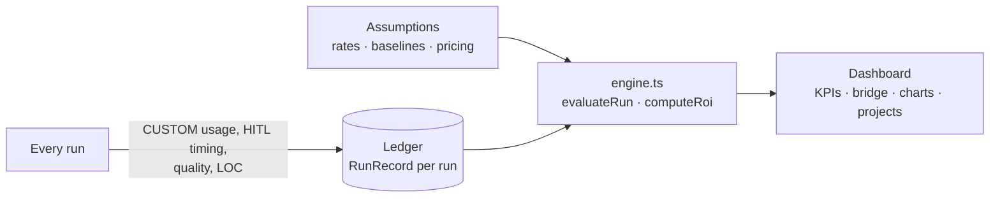

# 08 · ROI & business value

The ROI dashboard (`#/roi`) answers one question: **what did the platform save, and what did it cost?** It answers using measured run data plus explicit, editable assumptions.



## Measured (from the ledger)

Each `RunRecord` ([`types/roi.ts`](../src/types/roi.ts)) stores:

- **Run facts:** outcome, mode, duration (excluding human wait), and token usage per agent and tier, including cached tokens.
- **Human time:** HITL decisions and measured wait time.
- **Output:** components → complexity (≤12 simple, ≤18 medium, else complex), files, LOC.
- **Quality:** first-pass and final score, iterations, gaps auto-fixed and gaps remaining, hard gates.

Demo projects come from seeded **sample data** ([`sampleData.ts`](../src/services/roi/sampleData.ts)). They are flagged `sample`, never stored, and can be switched off.

## Assumed (editable in *Assumptions*)

Defaults are in [`config/roi.ts`](../src/config/roi.ts). They are assumptions, so calibrate them with real timesheets during the pilot.

| Assumption | Default |
|---|---|
| Rates per hour | design $70 · dev $75 · QA $55 |
| Manual hours per screen (design/dev/QA) | simple 3/6/2 · medium 5/12/3 · complex 8/20/5 |
| Remaining human hours after generation | simple 0.25/1/0.5 · medium 0.5/2/0.75 · complex 0.75/4/1 |
| Manual small-change hours (vs refine run) | 0.25/1/0.25 |
| Lead time without the platform | 3 / 5 / 8 working days |
| Token prices per 1M (input/output/cached) | small 1/5/0.1 · medium 3/15/0.3 · large 5/25/0.5 |
| Platform cost / build cost / amortisation | $400 per month · $12,000 · 12 months |
| Monthly AI budget · defect cost | $150 · $180 per late defect |
| Full-code LLM baseline | 12 tokens/LOC · 3 regeneration loops · 9,000 context tokens per call |

## Formulas ([`services/roi/engine.ts`](../src/services/roi/engine.ts))

Per run (`evaluateRun`):

```
baseline hours  = manual hours[complexity]                        (built screen)
                = manual small-change hours                        (refine run)
actual hours    = HITL review time + remaining hours[complexity]   (×1.5 if escalated)
labour saved    = Σ roles (baseline − actual) × rate
defects avoided = gaps auto-fixed × defect cost
AI cost         = Σ usage: fresh input × price + cached × cached price + output × price
cache savings   = uncached cost − AI cost
value           = labour saved + defects avoided
```

For the period (`computeRoi`):

```
investment = AI spend + platform cost (pro-rated) + build cost amortised
net value  = value − investment
ROI        = net value ÷ investment
payback    = investment ÷ daily value
```

The **baseline vs actual** comparisons cover engineering hours per screen, delivery cost per screen, lead time, tokens per screen (vs full-code regeneration), first-pass design-system compliance, and review-ready rate.

## Dashboard

- **Filters:** period (7 / 30 / 90 days / all), project, and the sample-data switch.
- **KPIs:** net value, ROI, hours saved, AI spend vs budget, screens delivered, AI cost per screen.
- **Charts:** value bridge, cumulative value vs investment, six baseline-vs-actual cards, hours by role, AI usage (tokens, cache hit rate, daily spend vs budget, spend by tier and by agent).
- **Projects:** a per-project table with click-to-focus and **CSV** export.
- **Methodology** notes explain every figure.

The charts are dependency-free SVG. They use a colour palette validated for colour-vision deficiency in light and dark mode, and every chart has a legend and hover tooltips.
