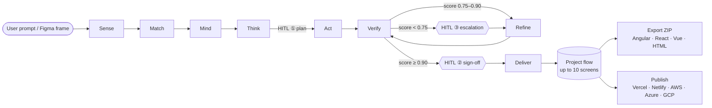

# AAVA Prompt-to-Product — Documentation

AAVA Prompt-to-Product turns a plain-language prompt (or a Figma frame) into verified, design-system-compliant UI screens, links them into a multi-screen product flow, and exports a runnable project in the tech stack you choose.

This folder documents how the system works, from the agent pipeline down to individual services.

## Start here

| If you want to… | Read |
|---|---|
| Understand what the product does and the key ideas | [01 · Overview](01-overview.md) |
| See how the code is organised | [02 · Architecture](02-architecture.md) |
| Understand the agents and the end-to-end flow | [03 · Agent pipeline](03-agent-pipeline.md) |
| Integrate a real backend | [04 · AG-UI & A2UI protocol](04-protocol.md) |
| Work on state, persistence or the reducer | [05 · State & persistence](05-state.md) |
| Work on code generation, export or publish | [06 · Codegen, export & publish](06-codegen-export-publish.md) |
| Work on databases, context resources or the prompt refiner | [07 · Data, context & prompt refine](07-data-and-context.md) |
| Understand ROI figures | [08 · ROI & business value](08-roi.md) |
| Change styling, theming or responsive behaviour | [09 · UI, theming & SCSS](09-ui-and-theming.md) |
| Set up, configure or extend the app | [10 · Developer guide](10-developer-guide.md) |
| Learn to use the app | [11 · User guide](11-user-guide.md) |

## One-minute summary

- **12 agents** across **8 steps**: 8 use an LLM (small, medium or large tier) and 4 are deterministic (codegen, accessibility audit, design lint, Playwright). See [03](03-agent-pipeline.md).
- The UI talks to the agents only through **AG-UI events**. It renders generated UI only from **A2UI v0.9** messages that use the **AAVA Play** component catalog.
- Everything works **offline** with a scripted mock agent and demo data. To use real services, set `VITE_AGENT_URL`, `VITE_DATA_API_URL` and `VITE_PUBLISH_URL`.

## Tech at a glance

React 19 · TypeScript (strict) · Vite 8 · Sass (CSS Modules) · Monaco editor · JSZip · IndexedDB/localStorage. No UI framework and no chart library.
